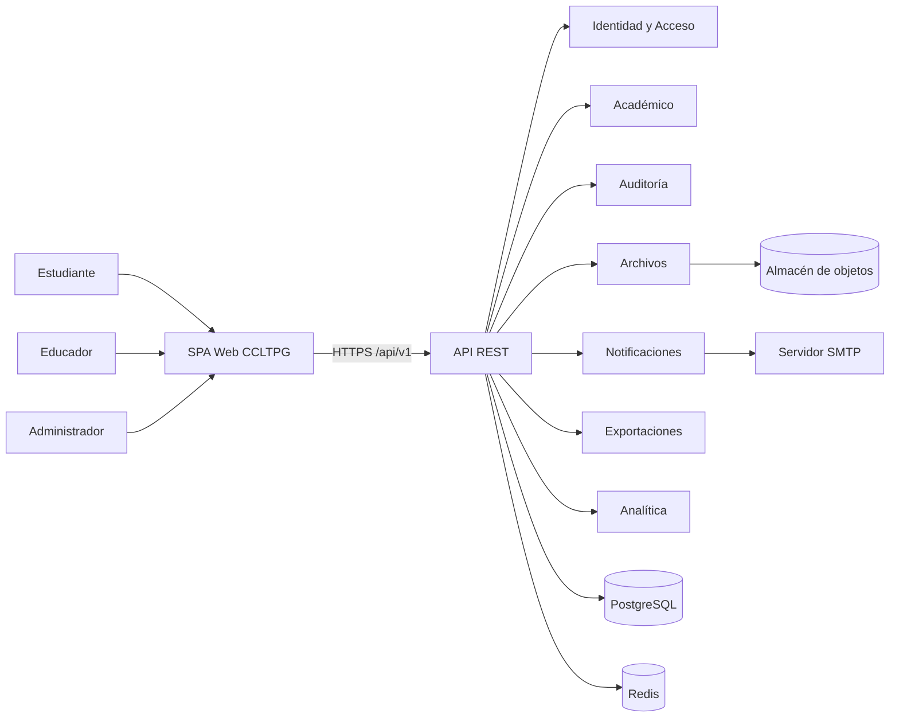

# Documento de Diseño Arquitectónico — Plataforma CCLTPG

*Archivo: `docs/diseno-arquitectonico.md` — Versión 1.0*

---

## 1. Propósito y alcance del documento

Este documento describe la arquitectura de software propuesta para la **Plataforma de Gestión del Centro Cultural Lucy Tejada (CCLTPG)** y la planificación estructurada de su desarrollo. Está dirigido a las personas que participan en el proyecto: equipo de desarrollo, líder de proyecto, representantes del personal administrativo, educadores, estudiantes y la dirección del centro.

El documento parte exclusivamente del **Documento de Visión y Alcance v1.0**, que define el problema de negocio (ON-1 a ON-4), las características del sistema (CAR-01 a CAR-12), el alcance por releases y las limitaciones del proyecto. Cualquier afirmación aquí contenida debe poder rastrearse hasta ese documento o hasta una decisión arquitectónica registrada en el capítulo 5.

**Qué contiene:** el estilo arquitectónico, las decisiones tecnológicas, los módulos y sus reglas de dependencia, el modelo de datos, el modelo de permisos, las máquinas de estado, los contratos transversales, la traducción de los requisitos no funcionales, la estrategia de pruebas, el plan de iteraciones con compuertas de revisión y los riesgos identificados.

**Qué no contiene:** reglas de negocio detalladas (viven en el catálogo de requisitos que se produce en la Iteración 0), contratos de API definitivos (se generan y congelan en cada compuerta) ni manuales de usuario.

**Fuente de verdad:** el Documento de Visión y Alcance, más los artefactos producidos y aprobados en la Iteración 0. Si dos especificaciones entran en conflicto, el conflicto se registra y se resuelve explícitamente; no se resuelve por suposición.

---

## 2. Requisitos que gobiernan la arquitectura

### 2.1 Características funcionales y su implicación arquitectónica

| ID | Característica (resumen) | Implicación arquitectónica principal | Release |
| --- | --- | --- | --- |
| CAR-01 | Registro de estudiantes e inscripción en programas con validación de cupos | Contexto **Académico** con modelo de programas, grupos, estudiantes y matrículas; validación transaccional de cupos | 1.0 |
| CAR-02 | Consulta del estudiante sobre matrícula, horarios, docente, salón y progreso | Portal de estudiante con permisos de lectura propia (`read_own`) y vistas filtradas por identidad | 1.0 |
| CAR-03 | Asistencia y evaluación cualitativa por parte de educadores | Contexto **Académico**: sesiones de clase, asistencia y evaluaciones con reglas de autoría | 1.0 |
| CAR-04 | Reportes automáticos exportables en Excel, PDF y CSV | Contexto **Exportaciones** con servicio de generación a partir de estructuras JSON saneadas | 2.0 |
| CAR-05 | Dashboards interactivos con métricas académicas | Contexto **Analítica** con consultas de solo lectura y caché con invalidación explícita | 2.0 |
| CAR-06 | 200 usuarios concurrentes, respuestas < 4 s en operaciones críticas | Arquitectura sin estado en la capa de aplicación, agrupación de conexiones, índices y pruebas de carga | 1.0 |
| CAR-07 | MFA, RBAC y cifrado SSL/TLS | Contexto **Identidad y Acceso** como espina dorsal de seguridad; evaluación de permisos declarativa y por defecto denegada | 1.0 |
| CAR-08 | Disponibilidad 99.9 %, DRP y backups | Arquitectura de despliegue con contenedores, respaldo continuo de PostgreSQL, runbooks y simulacros | 1.0 |
| CAR-09 | Notificaciones automáticas a estudiantes | Contexto **Notificaciones** dirigido por eventos de dominio | 2.0 |
| CAR-10 | Tres niveles de usuario con permisos diferenciados | Modelo de perfiles sobre una gramática única de permisos | 1.0 |
| CAR-11 | WCAG 2.1 y diseño responsivo | Decisiones de frontend, componentes accesibles y verificación automatizada en CI | 3.0 |
| CAR-12 | Trazabilidad de auditoría con usuario, fecha y hora | Contexto **Auditoría** con tabla de solo inserción y protección a nivel de base de datos | 1.0 |

### 2.2 Restricciones heredadas del alcance

- Plataforma **exclusivamente web**; no hay aplicaciones nativas.
- **Sin contabilidad, pagos en línea, nómina, inventario ni gestión de espacios.** La arquitectura no debe abrir camino a estas capacidades.
- **Sin integración automática** con la plataforma de la Alcaldía de Pereira; cualquier sincronización futura es un proyecto aparte.
- Los objetivos de disponibilidad, respaldo y recuperación dependen de la infraestructura y los servicios de alojamiento disponibles para el centro; la arquitectura los hace posibles y medibles, pero no los garantiza por sí sola.
- El sistema **no reemplaza decisiones académicas o administrativas**; provee información y herramientas.

---

## 3. Principios arquitectónicos

1. **Monolito modular antes que microservicios.** Un solo despliegue con contextos delimitados internos. El equipo es pequeño, la carga esperada es de 200 usuarios concurrentes y la complejidad operativa de los microservicios no se justifica. Los límites se hacen cumplir por código y por pruebas, no por red.
2. **Un contexto dueño por dato.** Cada tabla pertenece a un solo esquema y a un solo contexto. Ningún contexto lee o escribe el esquema de otro por SQL directo; la comunicación es por interfaces públicas o eventos de dominio.
3. **Por defecto, denegar.** Toda ruta nace sin acceso. El acceso se concede con un permiso explícito declarado en el código y verificado por pruebas de autorización (caso permitido y caso denegado).
4. **Auditoría por defecto.** Toda operación que cambia estado emite un evento de auditoría con actor, contexto, recurso, datos anteriores y posteriores. La tabla de auditoría es de solo inserción a nivel de base de datos.
5. **Contratos congelados.** En cada compuerta de revisión se congelan los artefactos acordados (modelo de datos, contratos de API, semántica de permisos). Modificarlos requiere una solicitud de cambio aprobada.
6. **Migraciones reversibles y de un solo esquema.** Cada migración se aplica y se revierte limpiamente sobre una base vacía y sobre la instantánea de la compuerta anterior.
7. **Reglas de negocio en el dominio, no en controladores ni en la interfaz.** El dominio no depende de frameworks, de la base de datos ni de HTTP.
8. **Sin lógica financiera.** El sistema registra documentos, referencias y estados, nunca ejecución de pagos ni asientos contables.
9. **Accesibilidad y protección de datos como requisitos de diseño**, no como tareas finales de maquillaje.
10. **Todo requisito es trazable a código y a prueba.** Una regla sin identificador de requisito o sin supuesto registrado no se implementa.

---

## 4. Estilo arquitectónico

### 4.1 Vista de contexto



### 4.2 Contextos delimitados

El sistema se organiza en un **núcleo compartido** (Shared Kernel) y un **contexto de negocio**:

| Contexto | Esquema | Responsabilidad | Requisitos |
| --- | --- | --- | --- |
| Identidad y Acceso | `public` | Usuarios, perfiles, permisos, sesiones, tokens, MFA, ciclo de vida de identidades temporales | CAR-07, CAR-10 |
| Auditoría | `public` | Registro inmutable de eventos, consulta administrativa | CAR-12 |
| Archivos | `public` | Carga, validación, almacenamiento, descarga autorizada y metadatos de documentos | CAR-01, CAR-03, CAR-04 |
| Notificaciones | `public` | Persistencia, entrega en aplicación y por correo, preferencias, plantillas | CAR-09 |
| Exportaciones | `public` | Generación de PDF, Excel y CSV desde estructuras de datos saneadas | CAR-04 |
| Analítica | `public` (vistas de lectura) | Consultas agregadas y KPIs para dashboards | CAR-05 |
| Académico | `academic` | Programas formativos, grupos, horarios, estudiantes, matrículas, asistencia, evaluaciones | CAR-01, CAR-02, CAR-03 |

**Reglas de dependencia:**

- Un contexto puede invocar las interfaces públicas del núcleo compartido y publicar/consumir eventos de dominio.
- Un contexto **nunca** importa las clases internas de otro contexto ni ejecuta SQL contra el esquema de otro.
- Las referencias entre contextos se guardan como identificadores lógicos (`uuid`) sin claves foráneas cruzadas; la integridad se garantiza en el contexto dueño.
- La capa de Analítica solo lee; no escribe en ningún esquema de negocio.

Estas reglas se verifican de forma automática (pruebas de arquitectura) y de forma manual en cada revisión.

### 4.3 Capas dentro de cada módulo

```
src/modules/<contexto>/
  domain/           # entidades, reglas, máquinas de estado, eventos (sin framework)
  application/      # casos de uso, puertos, DTOs internos
  infrastructure/   # repositorios, adaptadores, mapeos
  api/              # controladores REST, guards, esquemas OpenAPI
  tests/
```

La dirección de dependencia es `api → application → domain`; `infrastructure` implementa los puertos declarados por `application`. El dominio no conoce HTTP, ni SQL, ni el framework.

### 4.4 Comunicación entre módulos

- **Síncrona:** llamadas a interfaces públicas del núcleo compartido (por ejemplo, el servicio de archivos o el evaluador de permisos).
- **Asíncrona en proceso:** bus de eventos de dominio tipados, usado por notificaciones, auditoría y analítica. El bus garantiza aislamiento de fallos: un consumidor que falla no revierte la transacción de origen y se reintenta con una política explícita.

---

## 5. Decisiones tecnológicas

Cada decisión tiene una sola opción elegida. Las alternativas descartadas se mencionan para dejar constancia del criterio.

| Decisión | Elección | Justificación |
| --- | --- | --- |
| Lenguaje y framework backend | **TypeScript + NestJS** | Permite implementar el patrón declarativo de permisos con decoradores e interceptores, inyección de dependencias y separación por módulos; tipado fuerte compartido con el frontend |
| Acceso a datos y migraciones | **Kysely + migrador con `up`/`down`** | SQL tipado y control explícito de los esquemas; migraciones reversibles y conjuntos separados por esquema (`public`, `academic`) |
| Base de datos | **PostgreSQL 16** | Transacciones, integridad referencial, `jsonb` para auditoría, soporte de múltiples esquemas y roles, vistas materializadas para analítica |
| Caché y trabajos en segundo plano | **Redis + BullMQ** | Colas para notificaciones, exportaciones y tareas de desactivación; caché de dashboards y control de throttling |
| Almacenamiento de archivos | **Servicio compatible con S3** (MinIO en desarrollo) | Separación entre metadatos (PostgreSQL) y contenido binario; permite sustituir el proveedor sin tocar el dominio |
| Frontend | **React + Vite + TypeScript** | SPA con enrutamiento por rol y cliente de API generado desde OpenAPI |
| Kit de interfaz | **MUI (Material UI)** | Base de componentes con accesibilidad incorporada, alineada con CAR-11; permite temas y diseño responsivo |
| Gráficas de dashboards | **Recharts** | Componentes accesibles y suficientes para los KPIs definidos |
| Pruebas unitarias y de API | **Vitest + Supertest** | Rapidez y compatibilidad con el ecosistema TypeScript |
| Pruebas de integración | **Testcontainers (PostgreSQL real)** | Prohíbe simular la base de datos en pruebas de integración; valida migraciones y restricciones reales |
| Pruebas de extremo a extremo | **Playwright** | Recorridos completos de estudiante, educador y administrador, con verificación de accesibilidad |
| Pruebas de carga | **k6** | Escenarios de 200 usuarios concurrentes y medición de percentiles |
| Generación de PDF | **PDFKit con registro de plantillas** | Generación determinista en servidor, sin dependencia de un navegador headless |
| Generación de Excel y CSV | **ExcelJS + escritor CSV nativo** | Formatos exigidos por CAR-04 |
| Autenticación | **JWT de acceso de corta vida + refresh rotativo en cookie `httpOnly`; TOTP para MFA; Argon2id para contraseñas** | Cumple CAR-07 con rotación, revocación y protección CSRF |
| Correo electrónico | **Nodemailer detrás de una interfaz de canal** | Permite sustituir el proveedor SMTP sin cambiar el dominio |
| Tiempo real | **Server-Sent Events autenticados** | Entrega unidireccional suficiente para notificaciones; más simple que WebSockets |
| Linting y formato | **ESLint + Prettier, TypeScript en modo estricto** | Calidad homogénea y cero advertencias nuevas |
| Contenedores y orquestación local | **Docker + Docker Compose** | Entorno reproducible con un solo comando |
| Integración continua | **GitHub Actions** | Pipeline único para lint, tipos, pruebas, migraciones, OpenAPI y escaneo de dependencias |
| Observabilidad | **pino (logs estructurados) + OpenTelemetry + métricas Prometheus** | Correlación por `requestId`, trazas y alertas operativas |

El patrón de permisos declarativo (decorador sobre cada ruta más un guard global) es implementable en NestJS, lo que confirma la compatibilidad exigida por el diseño.

---

## 6. Estructura del repositorio y convenciones

### 6.1 Monorepo

```
/
  apps/
    api/                # Backend NestJS
    web/                # SPA React
  packages/
    contracts/          # Tipos y esquemas compartidos generados desde OpenAPI
    config/             # Configuración común de lint, TypeScript y pruebas
  infra/
    compose/            # Docker Compose de desarrollo
    deploy/             # Definiciones de despliegue y runbooks
  docs/
    requirements/       # Catálogo de requisitos (Iteración 0)
    tasks/              # Registro de tareas por iteración
    adr/                # Registros de decisión arquitectónica
    open-questions.md
    assumptions.md
  reviews/              # Paquetes de revisión por compuerta
```

### 6.2 Convenciones transversales

| Aspecto | Convención |
| --- | --- |
| Nombres en base de datos | `snake_case`, tablas en plural, esquema explícito |
| Nombres en API | `kebab-case` en rutas, `camelCase` en JSON |
| Nombres en código | `PascalCase` para tipos, `camelCase` para variables y funciones |
| Identificadores | UUIDv7 generados en la aplicación (ordenables por tiempo) |
| Fechas y horas | Almacenamiento en UTC (`timestamptz`); presentación en `America/Bogota` |
| Formato de error | Problem Details (RFC 9457): `type`, `title`, `status`, `detail`, `instance`, `code`, `errors[]`, `requestId` |
| Paginación | `page` y `pageSize` (máximo 100), más `sort` y filtros tipados por recurso |
| Versionado de API | Prefijo `/api/v1`; cambios aditivos permitidos, cambios rupturistas exigen `/v2` |
| Idempotencia | Cabecera `Idempotency-Key` obligatoria en creaciones con efectos secundarios (matrícula, cargas, exportaciones) |
| Documento de API | OpenAPI generado desde el código, versionado en el repositorio y verificado en CI contra cambios rupturistas |
| Borrado | Borrado lógico (`deleted_at`) solo donde el negocio lo exija; los registros de auditoría nunca se borran |

---

## 7. Modelo de datos v1

### 7.1 Reglas generales

- Dos esquemas: `public` (núcleo compartido) y `academic` (negocio).
- Claves primarias UUIDv7; claves foráneas con `ON DELETE RESTRICT` salvo indicación contraria.
- Sin claves foráneas entre esquemas: las referencias cruzadas son `uuid` validados por el contexto dueño.
- Enumeraciones implementadas como tipos `enum` de PostgreSQL.
- Columnas marcadas como sensibles se cifran a nivel de aplicación antes de persistir (ver capítulo 12).

### 7.2 Esquema `public`

| Tabla | Campos principales | Notas |
| --- | --- | --- |
| `usuario` | `id`, `email` (único), `password_hash`, `nombre`, `estado`, `mfa_habilitado`, `mfa_secret_cifrado`, `creado_en`, `actualizado_en` | Estado: `activo`, `inactivo`, `bloqueado` |
| `perfil` | `id`, `codigo` (único), `nombre`, `descripcion` | `estudiante`, `educador`, `administrador` |
| `permiso` | `id`, `codigo` (único, gramática del capítulo 8), `descripcion` | Catálogo cerrado, versionado por migración |
| `perfil_permiso` | `perfil_id`, `permiso_id` | Clave compuesta |
| `usuario_perfil` | `id`, `usuario_id`, `perfil_id`, `valid_until`, `asignado_por`, `creado_en` | `valid_until` nulo = sin caducidad; soporta identidades temporales |
| `refresh_token` | `id`, `usuario_id`, `token_hash`, `familia_id`, `expira_en`, `revocado_en`, `reemplazado_por`, `ip`, `user_agent` | Rotación y detección de reutilización |
| `evento_auditoria` | `id`, `actor_id`, `actor_perfil`, `ip`, `dispositivo`, `recurso`, `accion`, `datos_antes` (jsonb), `datos_despues` (jsonb), `ocurrido_en`, `request_id` | Solo inserción (capítulo 11) |
| `archivo` | `id`, `nombre_original`, `mime`, `tamano`, `hash_sha256`, `ruta_objeto`, `subido_por`, `estado_escaneo`, `creado_en` | `estado_escaneo`: `pendiente`, `limpio`, `infectado` |
| `notificacion` | `id`, `usuario_id`, `evento`, `canal`, `plantilla_id`, `payload` (jsonb), `estado`, `leida_en`, `enviada_en` | `canal`: `app`, `email` |
| `preferencia_notificacion` | `usuario_id`, `evento`, `canal`, `habilitado` | Permite al usuario silenciar canales no críticos |
| `plantilla_notificacion` | `id`, `codigo`, `canal`, `asunto`, `cuerpo` | Versionada por migración |

### 7.3 Esquema `academic`

| Tabla | Campos principales | Notas |
| --- | --- | --- |
| `programa_formativo` | `id`, `nombre`, `descripcion`, `area` (`danza`, `musica`, `teatro`, `artes_plasticas`), `cupo_maximo`, `estado`, `creado_en` | Estado: `borrador`, `publicado`, `archivado` |
| `grupo` | `id`, `programa_id`, `codigo`, `educador_id`, `salon`, `estado`, `periodo` | `educador_id` referencia lógica a `public.usuario`; Estado: `abierto`, `cerrado` |
| `horario_grupo` | `id`, `grupo_id`, `dia_semana`, `hora_inicio`, `hora_fin` | Validación de solapamiento por educador y por salón |
| `estudiante` | `id`, `usuario_id`, `tipo_documento`, `numero_documento` (único), `nombres`, `apellidos`, `fecha_nacimiento`, `municipio`, `barrio`, `direccion`, `telefono`, `acudiente`, `consentimiento_datos`, `creado_en` | `municipio` y `barrio` alimentan la distribución geográfica de CAR-05; el consentimiento respalda la Ley 1581 |
| `matricula` | `id`, `estudiante_id`, `grupo_id`, `estado`, `fecha_matricula`, `periodo`, `creado_en` | Única por (`estudiante_id`, `grupo_id`, `periodo`) |
| `sesion_clase` | `id`, `grupo_id`, `fecha`, `tema`, `estado` | Estado: `programada`, `realizada`, `cancelada` |
| `asistencia` | `id`, `sesion_id`, `matricula_id`, `estado`, `registrado_por`, `registrado_en` | Única por (`sesion_id`, `matricula_id`); Estado: `presente`, `ausente`, `tarde`, `excusa` |
| `indicador_evaluacion` | `id`, `programa_id`, `nombre`, `descripcion`, `escala` | Indicadores definidos por el centro |
| `evaluacion_cualitativa` | `id`, `matricula_id`, `indicador_id`, `periodo`, `valor`, `observacion`, `evaluado_por`, `evaluado_en` | Única por (`matricula_id`, `indicador_id`, `periodo`) |

### 7.4 Índices mínimos

- `usuario(email)`, `estudiante(numero_documento)`, `matricula(estudiante_id, periodo)`, `matricula(grupo_id, estado)`.
- `asistencia(sesion_id)`, `evento_auditoria(ocurrido_en)`, `evento_auditoria(actor_id, ocurrido_en)`.
- `notificacion(usuario_id, leida_en)`.
- Vistas materializadas para los KPIs de mayor costo, refrescadas por evento o por programación.

### 7.5 Descripción entidad-relación (resumen)

`usuario` se relaciona con `perfil` a través de `usuario_perfil`; `perfil` con `permiso` a través de `perfil_permiso`. En el esquema académico, `programa_formativo` agrupa `grupo`, que contiene `horario_grupo` y `sesion_clase`; `estudiante` se vincula a `grupo` mediante `matricula`; cada `sesion_clase` genera `asistencia` por matrícula; cada `matricula` recibe `evaluacion_cualitativa` sobre `indicador_evaluacion`.

---

## 8. Modelo de permisos

### 8.1 Gramática

Un único formato: `contexto:recurso:acción`.

- **Contextos:** `identity`, `academic`, `audit`, `files`, `notifications`, `exports`, `analytics`.
- **Vocabulario fijo de acciones:** `read`, `read_own`, `create`, `update`, `delete`, `export`, `manage`.
- **Comodines:** solo como segmento completo (`academic:*:read`). No se permiten comodines parciales.
- **Ámbito propio:** `read_own` y `update_own` se resuelven con verificación a nivel de fila contra el usuario autenticado.

Ejemplos: `academic:student:create`, `academic:enrollment:update`, `academic:attendance:create`, `academic:evaluation:create`, `academic:report:export`, `identity:user:manage`, `audit:event:read`, `academic:enrollment:read_own`.

### 8.2 Perfiles y asignación

| Perfil | Permisos representativos | MFA | Caducidad |
| --- | --- | --- | --- |
| Estudiante | `academic:enrollment:read_own`, `academic:schedule:read_own`, `academic:evaluation:read_own`, `notifications:*:read_own` | Opcional (disponible) | No |
| Educador | `academic:attendance:create`, `academic:attendance:update`, `academic:evaluation:create`, `academic:group:read_own`, `academic:report:export` | Obligatorio | No |
| Administrador | `identity:*:manage`, `academic:*:manage`, `audit:event:read`, `analytics:*:read`, `exports:*:create` | Obligatorio | No |
| Identidad temporal (acudiente, apoyo administrativo) | Definida por asignación explícita | Obligatorio | Sí (`valid_until`) |

Los perfiles se combinan por unión de permisos. Una identidad temporal deja de operar automáticamente al vencer `valid_until` mediante un trabajo programado que la desactiva y revoca sus tokens.

### 8.3 Evaluación

1. La ruta declara su permiso con un decorador.
2. Un guard global evalúa el permiso contra los perfiles vigentes del usuario.
3. Si la ruta no declara permiso, se rechaza (denegación por defecto), y una prueba automatizada lo verifica.
4. Los permisos con ámbito propio se resuelven además con una comprobación de propiedad del recurso.

La **matriz de autorización** (perfil × ruta protegida × resultado esperado) se mantiene como prueba ejecutable y se amplía en cada iteración.

---

## 9. Máquinas de estado

| Entidad | Estados | Transiciones permitidas | Quién transiciona | Efectos |
| --- | --- | --- | --- | --- |
| Matrícula | `preinscrita` → `confirmada` → `activa` → `finalizada` | `preinscrita→confirmada`, `confirmada→activa`, `activa→finalizada`, `preinscrita→cancelada`, `confirmada→cancelada`, `activa→retirada` | Administrador (confirmación y cancelación); sistema (activación al inicio del periodo); administrador (retiro y finalización) | Validación de cupo al confirmar; notificación al estudiante; evento de auditoría |
| Programa formativo | `borrador`, `publicado`, `archivado` | `borrador→publicado`, `publicado→archivado` | Administrador | Publicación habilita inscripciones; auditoría |
| Grupo | `abierto`, `cerrado` | `abierto→cerrado` | Administrador | Cierre impide nuevas matrículas; auditoría |
| Sesión de clase | `programada`, `realizada`, `cancelada` | `programada→realizada`, `programada→cancelada` | Educador dueño del grupo | Habilita o bloquea registro de asistencia |
| Usuario | `activo`, `inactivo`, `bloqueado` | `activo→inactivo`, `activo→bloqueado`, `bloqueado→activo`, `inactivo→activo` | Administrador; sistema (bloqueo por intentos fallidos) | Revocación de tokens; auditoría |

Toda transición inválida se rechaza con un error de dominio tipado y se cubre con una prueba. Cada transición emite un evento de auditoría y, cuando corresponde, una notificación.

---

## 10. Contratos transversales

### 10.1 Errores

Formato único Problem Details con `requestId`. Los errores de dominio se mapean a códigos estables (`ENROLLMENT_CAPACITY_EXCEEDED`, `INVALID_STATE_TRANSITION`, `PERMISSION_DENIED`, etc.) que el frontend traduce a mensajes de usuario.

### 10.2 Archivos

- Carga por `multipart/form-data` con límite de tamaño configurable (10 MB por defecto) y lista blanca de MIME (`pdf`, `png`, `jpg`, `docx`, `xlsx`).
- Cálculo de `hash_sha256`; política de deduplicación: se reutiliza el objeto físico, se registra un nuevo metadato.
- Gancho de análisis antimalware detrás de una interfaz, con implementación inicial documentada como stub.
- Descarga siempre autorizada por permiso y registrada en auditoría.

### 10.3 Notificaciones

Catálogo mínimo para el Release 1.0 y 2.0:

| Evento | Destinatario | Canal | Plantilla |
| --- | --- | --- | --- |
| `matricula.creada` | Estudiante | App, correo | `matricula-creada` |
| `matricula.confirmada` | Estudiante | App, correo | `matricula-confirmada` |
| `matricula.cancelada` | Estudiante | App, correo | `matricula-cancelada` |
| `horario.modificado` | Estudiantes del grupo | App, correo | `horario-modificado` |
| `evaluacion.publicada` | Estudiante | App | `evaluacion-publicada` |
| `recordatorio.fechas` | Estudiantes | App, correo | `recordatorio-fechas` |

El servicio expone una API de disparo dirigida por eventos y respeta las preferencias del usuario; las notificaciones marcadas como críticas no son silenciables.

### 10.4 Exportaciones

- Entrada: una estructura JSON saneada y una plantilla registrada. El servicio no consulta la base de datos directamente.
- Salidas: PDF (PDFKit), Excel (ExcelJS), CSV.
- Cada generación se audita con actor, plantilla, filtros y formato.

### 10.5 Eventos de dominio

Catálogo inicial: `usuario.creado`, `usuario.desactivado`, `matricula.creada`, `matricula.confirmada`, `matricula.retirada`, `asistencia.registrada`, `evaluacion.registrada`, `archivo.subido`, `reporte.generado`. Los consumidores son notificaciones, auditoría y analítica. El bus garantiza orden por agregado y aislamiento de fallos.

---

## 11. Auditoría y trazabilidad (CAR-12)

- **Tabla de solo inserción:** el rol de aplicación no tiene privilegios `UPDATE` ni `DELETE` sobre `evento_auditoria`; un disparador de base de datos rechaza cualquier intento, incluso por SQL directo.
- **Contenido mínimo:** actor, perfil activo, IP, dispositivo, recurso, acción, datos anteriores y posteriores (con campos sensibles redactados o seudonimizados), fecha y hora, `requestId`.
- **Corrección:** no se modifica el pasado; se registran eventos compensatorios con justificación obligatoria.
- **Consulta:** endpoint exclusivo para administradores, con filtros por actor, recurso, acción y rango temporal.
- **Minimización:** los datos personales sensibles no se copian completos en la auditoría; se guardan identificadores y diferencias de campos no sensibles, de modo que una solicitud de supresión no obligue a alterar el registro histórico.

---

## 12. Seguridad (CAR-07)

| Control | Implementación |
| --- | --- |
| Contraseñas | Argon2id con parámetros versionados |
| Sesión | Access token de 15 minutos; refresh rotativo de 7 días en cookie `httpOnly`, `Secure`, `SameSite=Strict`; detección de reutilización y revocación de familia |
| MFA | TOTP obligatorio para administrador y educador; recuperación con códigos de un solo uso |
| CSRF | Token de doble envío para operaciones mutantes |
| Throttling | Límite por IP y por usuario en login, MFA y recuperación |
| Cabeceras | HSTS, CSP, `X-Content-Type-Options`, `Referrer-Policy`, `Permissions-Policy` |
| Transporte | TLS 1.2 o superior obligatorio |
| Cifrado en reposo | Cifrado a nivel de aplicación de columnas designadas como sensibles (documento, contacto, dirección), con clave gestionada en el gestor de secretos |
| Roles de base de datos | `ccltpg_migrator` (DDL), `ccltpg_app` (DML sin DDL, sin privilegios sobre auditoría), `ccltpg_readonly` (vistas analíticas) |
| Secretos | Gestor de secretos del entorno; nunca en el repositorio |
| Dependencias | Escaneo automático en CI y política de actualización |

---

## 13. Privacidad y protección de datos (Ley 1581 de 2012 y Decreto 1377 de 2013)

- **Inventario de datos personales:** estudiante, acudiente, usuario, direcciones y contactos; finalidad declarada por cada tratamiento.
- **Consentimiento:** campo `consentimiento_datos` en `estudiante`, con fecha y versión del aviso de privacidad.
- **Derechos del titular:** procedimiento documentado de acceso, corrección y supresión; la supresión se implementa como anonimización cuando exista un deber de conservación.
- **Retención:** plazos definidos por tipo de dato; los registros de auditoría se conservan según la política institucional y se minimizan desde su creación.
- **Acceso a PII:** toda consulta a datos personales sensibles queda auditada; los reportes exportados se registran y se someten a la misma autorización que la consulta de origen.
- **Conflicto con la inmutabilidad:** se resuelve por diseño (minimización en auditoría y seudonimización), no alterando registros históricos.

---

## 14. Traducción de requisitos no funcionales

| Requisito | Meta medible | Mecanismo |
| --- | --- | --- |
| CAR-06 Rendimiento | 200 usuarios concurrentes; p95 < 4 s en operaciones críticas | Pruebas k6 por escenario, agrupación de conexiones, índices revisados, caché de dashboards, consultas analíticas sobre vistas materializadas |
| CAR-08 Disponibilidad | 99.9 % mensual (≈ 43 min de indisponibilidad) | Dos réplicas de la API, PostgreSQL con respaldo continuo (WAL), verificaciones de salud, despliegues sin caída, alertas |
| CAR-08 Respaldos y DRP | RPO ≤ 15 min, RTO ≤ 4 h (sujeto a la infraestructura disponible) | Respaldos automáticos + archivado de WAL, simulacro de restauración documentado y ejecutado en cada compuerta relevante |
| CAR-11 Accesibilidad | WCAG 2.1 nivel AA | Componentes accesibles de MUI, auditoría `axe` en CI, recorrido manual con teclado y lector de pantalla en los flujos críticos, contraste y foco visibles |
| CAR-11 Responsividad | Puntos de quiebre 360, 768, 1024 y 1440 px | Diseño responsivo verificado en los tres navegadores del entorno de operación |
| CAR-07 Seguridad | Controles del capítulo 12 | Pruebas de autorización, escaneo de dependencias y contenedores, revisión de cabeceras y configuración TLS |

Aquellos objetivos que dependen de la infraestructura de alojamiento se documentan como **requisitos de despliegue** y se verifican en el entorno de preproducción; el código no puede garantizarlos por sí solo.

---

## 15. Arquitectura del frontend

- SPA React con enrutamiento declarativo por perfil; la navegación se genera desde los permisos del usuario autenticado, pero la autorización real siempre ocurre en el backend.
- Cliente de API generado desde OpenAPI; los tipos de `packages/contracts` son la única fuente de verdad para las formas de datos.
- Sesión: access token en memoria y refresh en cookie `httpOnly`; renovación silenciosa y cierre de sesión por revocación.
- Estados de carga, error y vacío estandarizados; mensajes de error traducidos desde los códigos estables del backend.
- Accesibilidad: etiquetas, roles, foco gestionado, navegación por teclado y contraste; auditoría automatizada en CI.
- Diseño responsivo con rejillas fluidas y componentes adaptativos.

---

## 16. Despliegue, operación y CI/CD

### 16.1 Entornos

| Entorno | Propósito | Datos |
| --- | --- | --- |
| Desarrollo | Trabajo diario con Docker Compose | Semilla sintética |
| Preproducción (staging) | Validación de cambios y nuevas funcionalidades antes de producción | Copia anonimizada o semilla representativa |
| Producción | Operación del centro | Datos reales |

### 16.2 Pipeline de integración continua

1. Lint y formato.
2. Verificación de tipos.
3. Pruebas unitarias.
4. Pruebas de integración contra PostgreSQL real (Testcontainers).
5. Verificación de migraciones: `up`, `down`, `up` sobre base vacía y sobre la instantánea de la compuerta anterior.
6. Generación de OpenAPI y detección de cambios rupturistas en contratos congelados.
7. Pruebas de arquitectura (importaciones cruzadas y accesos a esquemas ajenos).
8. Escaneo de dependencias y de imágenes de contenedor.
9. Pruebas de extremo a extremo y de accesibilidad en el entorno de preproducción.

### 16.3 Operación

- Contenedores inmutables con etiquetas versionadas.
- Migraciones ejecutadas como paso previo al despliegue, con respaldo previo y procedimiento de reversión documentado.
- Observabilidad: logs estructurados con `requestId`, trazas OpenTelemetry, métricas Prometheus y alertas por latencia, errores y saturación.
- Runbooks de despliegue, reversión, respaldo/restauración y recuperación ante desastres, con tiempos medidos en simulacros.

---

## 17. Estrategia de pruebas

| Nivel | Herramienta | Cobertura mínima |
| --- | --- | --- |
| Unitaria | Vitest | Reglas de negocio, máquinas de estado, validaciones |
| Integración | Testcontainers + PostgreSQL real | Repositorios, migraciones, restricciones, transacciones |
| API | Supertest | Contratos, códigos de error, paginación, idempotencia |
| Autorización | Matriz ejecutable | Cada ruta protegida con caso permitido y caso denegado, incluido el ámbito propio |
| Contrato | Verificación OpenAPI | Sin cambios rupturistas en artefactos congelados |
| Extremo a extremo | Playwright | Recorridos de estudiante, educador y administrador |
| Carga | k6 | Escenarios críticos a 200 usuarios concurrentes |
| Accesibilidad | axe + revisión manual | Flujos críticos en cada compuerta de release |

Reglas: ninguna prueba se desactiva, debilita ni simula la base de datos para hacer pasar una funcionalidad; las pruebas de autorización son parte obligatoria de la definición de terminado.

---

## 18. Plan de desarrollo por iteraciones y compuertas

Cada iteración termina en una **compuerta de revisión humana** obligatoria. El equipo se detiene, produce un paquete de revisión y espera aprobación explícita antes de continuar. El propósito es evitar que un error de modelo de datos, de permisos o de límites entre módulos se propague a todo lo demás.

### 18.1 Resumen

| # | Iteración | Release | Riesgo principal que retira | Foco de la compuerta |
| --- | --- | --- | --- | --- |
| 0 | Cierre de especificación (sin código) | — | Suposiciones sobre reglas y modelo de datos | Documentos completos y consistentes |
| 1 | Esqueleto caminante | 1.0 | Errores de herramientas y estructura | Montaje limpio y pruebas de arquitectura |
| 2 | Identidad, RBAC y auditoría | 1.0 | Fallos de seguridad | Matriz de autorización e inmutabilidad de auditoría |
| 3 | Archivos, notificaciones y exportaciones | 1.0 | Contratos compartidos inestables | Congelamiento de contratos |
| 4 | Académico A: programas, grupos, estudiantes, matrícula | 1.0 | Patrón de módulo equivocado | Aprobación del patrón |
| 5 | Académico B: asistencia y evaluación + endurecimiento | 1.0 | Rendimiento, respaldos, regresiones | Aceptación del Release 1.0 |
| 6 | Reportes, dashboards y notificaciones | 2.0 | KPIs y reportes incorrectos | Verificación manual de datos |
| 7 | Accesibilidad y compatibilidad responsiva | 3.0 | Brechas de accesibilidad | Auditoría WCAG 2.1 AA |
| 8 | Endurecimiento de seguridad, operación y aceptación final | 3.0 | Brechas no funcionales y de cumplimiento | Aceptación final y trazabilidad |

### 18.2 Detalle por iteración

**Iteración 0 — Cierre de especificación.** Catálogo de requisitos con criterios de aceptación verificables; registro de decisiones tecnológicas; reglas de repositorio y convenciones; modelo de permisos unificado; modelo de datos v1 con diccionario; máquinas de estado; reglas de negocio y validaciones; catálogo de notificaciones, reportes y KPIs; mecanismo de auditoría y de solo inserción; traducción de requisitos no funcionales; refinamiento del plan. **Compuerta 0:** todo requisito tiene criterio de aceptación o una pregunta abierta con responsable y valor por defecto.

**Iteración 1 — Esqueleto caminante.** Estructura del monorepo, entorno contenerizado con un solo comando, pipeline de CI completo, migraciones separadas por esquema, esqueleto de backend y frontend, pruebas de arquitectura. **Compuerta 1:** clonar, ejecutar y obtener el sistema funcionando con CI en verde; las pruebas de arquitectura fallan cuando se introduce una violación deliberada.

**Iteración 2 — Identidad, RBAC y auditoría.** Migraciones del núcleo, autenticación con MFA y refresh rotativo, motor de permisos con decorador y denegación por defecto, auditoría inmutable, ciclo de vida de identidades temporales, datos semilla, interfaz mínima de administración. **Compuerta 2:** intentos manuales de escalada de privilegios; rutas sin decorador rechazadas por prueba; auditoría inalterable por el rol de aplicación. **Congelamiento:** flujos de autenticación, modelo de tokens, semántica de RBAC y esquema de auditoría.

**Iteración 3 — Archivos, notificaciones y exportaciones.** Servicio de archivos con lista blanca y descarga autorizada, servicio de notificaciones con canales y preferencias, servicio de exportaciones con registro de plantillas y un reporte de muestra, bus de eventos de dominio. **Compuerta 3:** abuso de cargas y descargas, destinatarios correctos, documentos generados abiertos correctamente. **Congelamiento:** contratos de los tres servicios.

**Iteración 4 — Académico A.** Migraciones del esquema `academic`; dominio y casos de uso de programas, grupos, estudiantes y matrícula con validación de cupos, duplicados y solapamiento de horarios; endpoints con permisos y auditoría; pantallas de administración, portal de estudiante y vista de educador; notificaciones de matrícula. **Compuerta 4:** revisión del patrón de módulo y de un caso de uso completo de extremo a extremo. Si el patrón es incorrecto, se corrige aquí y no se replica.

**Iteración 5 — Académico B y Release 1.0.** Asistencia, evaluación cualitativa, cifrado de columnas sensibles, auditoría de acceso a PII, prueba de carga al nivel objetivo, procedimiento de respaldo y restauración probado, definición de despliegue en preproducción, suite de regresión y recorridos de extremo a extremo. **Compuerta 5:** demostración, prueba de carga y simulacro de restauración. **Congelamiento:** API y esquema académico. Etiqueta `release-1.0-rc`.

**Iteración 6 — Reportes, dashboards y notificaciones (Release 2.0).** Catálogo de reportes sobre el servicio de exportaciones; endpoints de KPIs con consultas definidas y caché con invalidación explícita; interfaz de dashboards para administración y educadores; catálogo completo de notificaciones académicas y preferencias del usuario. **Compuerta 6:** verificación manual de tres reportes y tres KPIs contra los datos crudos.

**Iteración 7 — Accesibilidad y responsividad (Release 3.0).** Auditoría y remediación a WCAG 2.1 AA, verificación automatizada en CI y recorrido manual con teclado y lector de pantalla en los flujos críticos, verificación responsiva en los puntos de quiebre definidos y en los navegadores del entorno de operación. **Compuerta 7:** informe de accesibilidad y evidencias por flujo.

**Iteración 8 — Endurecimiento y aceptación final.** Escaneos de dependencias y contenedores, revisión de cabeceras, saneamiento de entradas, límites de tasa, gestión de secretos, configuración TLS; revisión del inventario de datos personales, retención y procedimiento de supresión compatible con la auditoría; observabilidad, runbooks de despliegue, reversión y recuperación con tiempos medidos; prueba de carga y soak; documentación de usuario, administración y desarrollo; matriz de trazabilidad requisito → código → prueba. **Compuerta 8:** aceptación final y etiqueta `release-3.0`.

### 18.3 Congelamiento de contratos

| Compuerta | Artefactos congelados |
| --- | --- |
| 0 | Decisiones tecnológicas, estructura del repositorio, convenciones, catálogo de requisitos, modelo de datos v1, gramática de permisos, máquinas de estado, formato de errores |
| 2 | Flujos de autenticación, modelo de tokens, semántica de RBAC, esquema de auditoría |
| 3 | Contratos de archivos, notificaciones y exportaciones |
| 5 | API y esquema académico (Release 1.0) |
| 6 | Contratos de reportes y dashboards (Release 2.0) |
| 8 | Contratos del sistema completo (Release 3.0) |

### 18.4 Puntos de control internos

Cada iteración se divide en puntos de control revisables en menos de 30 minutos. El equipo publica el avance y solo continúa con tareas que no dependan de trabajo no revisado. Los puntos obligatorios son: aprobación del stack (Iteración 0), demostración del esqueleto (1), matriz de autorización (2), revisión de contratos compartidos (3), revisión del caso de uso completo (4), verificación de KPIs (6).

### 18.5 Criterios de reinicio

Se detiene el avance y se reconsidera el enfoque, con decisión humana, si en alguna compuerta se cumple una de estas condiciones:

- Más del 20 % de las tareas de la iteración exigieron modificar artefactos congelados.
- La matriz de autorización presenta vacíos en más de un módulo.
- Las migraciones no se aplican limpiamente desde la instantánea de la compuerta anterior.
- La misma violación arquitectónica (acceso cruzado a esquemas, lógica de negocio en controladores) aparece en dos iteraciones consecutivas.
- La revisión detecta que el modelo de datos necesita un cambio estructural (nueva entidad central u cambio de propiedad) después de la Compuerta 2.

Las correcciones baratas (nombres, un índice faltante, una validación) no son motivo de reinicio: se resuelven en la primera tarea de la iteración siguiente.

---

## 19. Definición de terminado y control de deriva

### 19.1 Definición de terminado (por tarea)

- El código compila; lint, formato y verificación de tipos pasan sin advertencias nuevas.
- Las pruebas unitarias cubren las reglas de negocio; las de integración se ejecutan contra PostgreSQL real en contenedor.
- Toda ruta nueva declara su permiso, tiene prueba de autorización permitida y denegada, y emite eventos de auditoría cuando cambia estado.
- La migración es reversible, de un solo esquema y se aplica limpiamente sobre base vacía y sobre la instantánea anterior.
- OpenAPI regenerado y versionado; sin cambios rupturistas en contratos congelados.
- Documentación actualizada: README del módulo, diccionario de datos, supuestos.
- Registro de tarea escrito: qué cambió, por qué y qué no se hizo.

### 19.2 Lista de verificación anti-deriva (en cada compuerta)

1. ¿Algún código accedió a las partes internas o al esquema de otro contexto?
2. ¿Toda ruta nueva está protegida por un permiso explícito y cubierta por pruebas permitidas y denegadas?
3. ¿Toda operación que cambia estado emite un evento de auditoría?
4. ¿Todo campo de estado nuevo tiene máquina de estados documentada y transiciones inválidas probadas?
5. ¿Las migraciones se mantienen en un solo esquema y pasan `up`/`down`/`up`?
6. ¿Se modificó algún artefacto congelado? ¿Qué solicitud de cambio lo autorizó?
7. ¿Se agregó alguna dependencia fuera de las decisiones tecnológicas registradas?
8. ¿Existe lógica de pagos o contabilidad? No debe existir.
9. ¿Hay reglas implementadas sin trazabilidad a un requisito o a un supuesto registrado?
10. ¿Las garantías de solo inserción se aplican a nivel de base de datos y no solo en el código?
11. ¿Alguna prueba fue omitida, debilitada o simulada de forma que oculte comportamiento real?
12. ¿Documentación, OpenAPI y diccionario de datos coinciden con el código?

### 19.3 Guía de revisión humana (orden de prioridad)

1. Documentos de la Compuerta 0: es el lugar más barato para corregir.
2. Matriz de autorización y protecciones de auditoría de la Compuerta 2: los errores de seguridad se acumulan.
3. Patrón de módulo de la Compuerta 4: todos los módulos posteriores lo copian.
4. Diferencias del modelo de datos en cada compuerta: leer las migraciones antes que el código.
5. Trazabilidad en la Compuerta 8: ningún requisito sin prueba.

Profundidad sugerida: leer primero el paquete de revisión, ejecutar el guion de demostración, leer todas las migraciones y los cambios de OpenAPI, muestrear el código de los archivos de mayor riesgo (verificación de permisos, transiciones de estado, repositorios) y luego aprobar, solicitar cambios o invocar los criterios de reinicio.

### 19.4 Paquete de revisión por compuerta

Cada compuerta produce un documento con: alcance entregado frente al planificado, decisiones y supuestos con su reversibilidad (barata o costosa), preguntas abiertas, informe de pruebas y matriz de autorización, guion de demostración reproducible, resumen de diferencias (tablas, rutas, permisos, migraciones, dependencias), defectos y deuda técnica conocidos, y autoevaluación contra la lista anti-deriva.

---

## 20. Riesgos arquitectónicos y mitigaciones

| Riesgo | Impacto | Mitigación | Señal de alerta |
| --- | --- | --- | --- |
| Expansión de alcance hacia pagos, contabilidad o inventario | Alto | Prohibición explícita en los principios y en la lista anti-deriva; propuestas separadas | Aparece un campo de pago o una tabla contable |
| Acoplamiento entre contextos por accesos cruzados a esquemas | Alto | Pruebas de arquitectura, roles de base de datos por esquema, revisión en cada compuerta | Importaciones cruzadas o SQL contra esquema ajeno |
| Modelo de datos estructuralmente equivocado descubierto tarde | Alto | Iteración 0 rigurosa y congelamiento en la Compuerta 2 | Cambio de propiedad de una entidad después de la Compuerta 2 |
| KPIs o reportes incorrectos | Medio | Verificación manual contra datos crudos en la Compuerta 6 | Discrepancias entre dashboard y consulta directa |
| Conflictos entre inmutabilidad de auditoría y derechos de supresión | Medio | Minimización y seudonimización desde el diseño | Solicitudes de borrado que exigirían alterar auditoría |
| Objetivos de disponibilidad no alcanzables con la infraestructura disponible | Alto | Documentarlos como requisitos de despliegue y verificarlos en preproducción | Incidentes por causas de infraestructura no cubiertas por el runbook |
| Deuda de accesibilidad detectada al final | Medio | Auditoría automatizada desde la Iteración 1 y revisión manual en la Compuerta 7 | Aumento sostenido de hallazgos de `axe` |
| Migraciones no reversibles o fuera de esquema | Medio | Verificación `up`/`down`/`up` en CI en cada iteración | Fallo del paso de migraciones en el pipeline |
| Pruebas frágiles o lentas que se desactivan | Medio | Prohibición explícita; revisión en la lista anti-deriva | Pruebas omitidas o marcadas como inestables |
| Notificaciones duplicadas o en bucle | Bajo | Idempotencia por evento y consumidor, pruebas de orden y aislamiento | Aumento anómalo de envíos en observabilidad |

---

## 21. Trazabilidad requisito → módulo → iteración

| Requisito | Contexto(s) | Iteración | Compuerta |
| --- | --- | --- | --- |
| CAR-01 | Académico, Archivos | 4 | 4 y 5 |
| CAR-02 | Académico (ámbito propio), Frontend | 4 | 4 |
| CAR-03 | Académico | 5 | 5 |
| CAR-04 | Exportaciones, Académico | 6 | 6 |
| CAR-05 | Analítica, Frontend | 6 | 6 |
| CAR-06 | Transversal (rendimiento) | 1, 5, 8 | 5 y 8 |
| CAR-07 | Identidad y Acceso | 2 | 2 |
| CAR-08 | Operación y despliegue | 1, 5, 8 | 5 y 8 |
| CAR-09 | Notificaciones | 3, 6 | 3 y 6 |
| CAR-10 | Identidad y Acceso | 2 | 2 |
| CAR-11 | Frontend transversal | 1, 7 | 7 |
| CAR-12 | Auditoría | 2 | 2 |

Cada fila se materializa en la matriz de trazabilidad final (requisito → código → prueba) que se verifica en la Compuerta 8.

---

## 22. Glosario

- **Compuerta:** punto de parada obligatoria con revisión y aprobación humana antes de continuar.
- **Contexto delimitado:** módulo con responsabilidad, datos y contratos propios.
- **Núcleo compartido:** conjunto de servicios reutilizables (identidad, auditoría, archivos, notificaciones, exportaciones, analítica) que todos los módulos pueden consumir a través de sus interfaces públicas.
- **Artefacto congelado:** documento, contrato o esquema que no puede modificarse sin una solicitud de cambio aprobada.
- **Ámbito propio (`own`):** permiso que solo aplica sobre los recursos del usuario autenticado.
- **Solo inserción:** propiedad de una tabla que impide actualizaciones y borrados a nivel de base de datos.
- **Paquete de revisión:** documento que el equipo entrega en cada compuerta para su aprobación.
- **Instantánea de compuerta:** copia del esquema y los datos semilla que sirve para probar migraciones posteriores.

---
